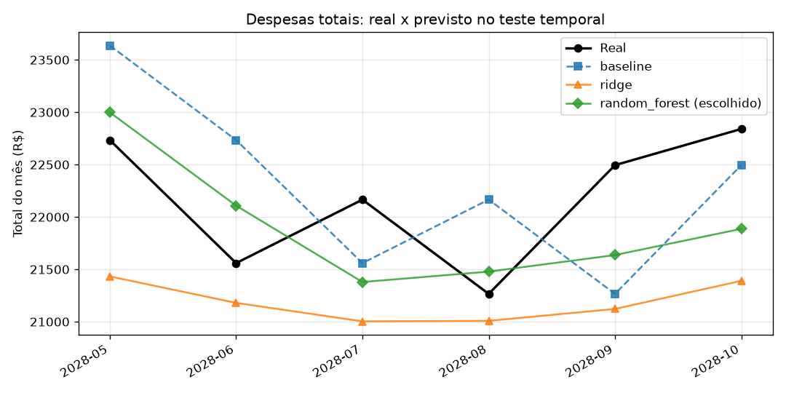

# Habita+

[](https://github.com/)
[](https://nodejs.org/)
[](https://nestjs.com/)
[](https://react.dev/)
[](https://python.org/)
[](LICENSE)

Sistema inteligente de gestão condominial para síndicos, administradores e moradores, com automações financeiras, manutenção, comunicação e previsões de consumo.

O Habita+ centraliza processos essenciais de um condomínio em uma plataforma moderna, ajudando a reduzir retrabalho, melhorar a comunicação e facilitar a tomada de decisão com suporte de inteligência artificial.

## Demonstração



## Funcionalidades

- Gestão de moradores, unidades e blocos
- Cobranças, pagamentos e integração com Stripe
- Tickets de manutenção e acompanhamento de chamados
- Comunicação interna e avisos para o condomínio
- Marketplace interno para serviços e parceiros
- Dashboard com indicadores de desempenho e saúde financeira
- Inteligência artificial para previsões e classificação de dados
- Autenticação com JWT e controle de acesso por perfil
- Arquitetura pronta para Docker e Kubernetes

## Pré-requisitos e dependências

Antes de rodar o projeto, certifique-se de ter instalado:

- Node.js 24+
- npm
- Python 3.11+
- Docker e Docker Compose v2
- Kubernetes CLI (`kubectl`) para a opção de deploy em cluster
- Stripe CLI para testes de webhook local
- PostgreSQL local ou um banco externo acessível

## Como instalar e rodar

### 1) Clone o repositório

```bash
git clone <url-do-repositorio>
cd habita-plus
```

### 2) Configure as variáveis de ambiente

```bash
cp .env.example .env
cp backend/.env.example backend/.env
cp frontend/.env.example frontend/.env
```

Exemplo de `.env` na raiz:

```env
DB_USER=habita
DB_PASSWORD=sua_senha_forte
DB_NAME=habitaplus
DB_PORT=5432
DB_SSL=false
JWT_SECRET=sua_chave_secreta
JWT_EXPIRES_IN_SECONDS=3600
STRIPE_SECRET_KEY=sk_test_...
STRIPE_WEBHOOK_SECRET=whsec_...
STRIPE_SUCCESS_URL=http://localhost:5173/success
STRIPE_CANCEL_URL=http://localhost:5173/cancel
BACKEND_PORT=3000
ML_PORT=8000
CORS_ORIGIN=http://localhost:5173
```

Exemplo de `backend/.env`:

```env
NODE_ENV=development
PORT=3000
CORS_ORIGIN=http://localhost:5173
DB_HOST=localhost
DB_PORT=5432
DB_USER=habita
DB_PASSWORD=sua_senha_forte
DB_NAME=habitaplus
DB_SSL=false
JWT_SECRET=sua_chave_secreta
JWT_EXPIRES_IN_SECONDS=3600
STRIPE_SECRET_KEY=sk_test_...
STRIPE_WEBHOOK_SECRET=whsec_...
STRIPE_SUCCESS_URL=http://localhost:5173/success
STRIPE_CANCEL_URL=http://localhost:5173/cancel
```

Exemplo de `frontend/.env`:

```env
VITE_API_URL=http://localhost:3000
VITE_USE_MOCKS=false
```

---

## Opção A: rodar com Docker

A stack principal do projeto inclui PostgreSQL, backend e ML service via Docker Compose. O frontend é executado localmente em desenvolvimento, a menos que você queira rodá-lo em um container separado.

### Subir os serviços

```bash
docker compose up --build
```

Se o banco estiver vazio, rode as migrations e o seed do backend:

```bash
docker compose exec backend npm run migration:run
docker compose exec backend npm run seed
```

### Verificar os serviços

- Backend: http://localhost:3000/api
- Swagger: http://localhost:3000/docs
- Healthcheck do backend: http://localhost:3000/api/health
- ML Service: http://localhost:8000/health
- PostgreSQL: localhost:5432

### Comandos úteis

```bash
docker compose ps
docker compose logs -f backend
docker compose logs -f ml-service
docker compose down
docker compose down -v
```

> `docker compose down` mantém os dados do banco; `docker compose down -v` remove o volume do PostgreSQL.

### Frontend em container (opcional)

```bash
docker build -t habitaplus-frontend ./frontend
docker run --rm -p 80:80 habitaplus-frontend
```

Acesse em:

```text
http://localhost:80
```

---

## Opção B: rodar sem Docker

Este é o fluxo recomendado para desenvolvimento local e testes com Stripe.

### 1. Subir o PostgreSQL local

```bash
docker compose up -d postgres
```

### 2. Instalar e rodar o backend

```bash
cd backend
npm install
npm run migration:run
npm run seed
npm run start:dev
```

O backend ficará disponível em:

```text
http://localhost:3000
```

### 3. Rodar o ML service

```bash
cd ml-service
python -m venv .venv
source .venv/bin/activate
pip install -r requirements.txt
uvicorn app.main:app --host 0.0.0.0 --port 8000 --reload
```

O serviço de ML ficará em:

```text
http://localhost:8000
```

### 4. Rodar o frontend

```bash
cd frontend
npm install
npm run dev
```

Acesse:

```text
http://localhost:5173
```

### 5. Configurar webhook do Stripe

Em outro terminal:

```bash
stripe login
stripe listen --events checkout.session.completed --forward-to localhost:3000/api/webhooks/stripe
```

Copie o valor exibido, como `whsec_...`, para a variável `STRIPE_WEBHOOK_SECRET` no arquivo `.env`.

---

## Opção C: rodar com Kubernetes

Existe um manifesto de exemplo em `k8s/habitaplus.yaml` para deployment em cluster Kubernetes, incluindo backend, ML service e frontend.

### 1. Build das imagens

```bash
docker build -t habitaplus-backend:1.0 ./backend
docker build -t habitaplus-ml:1.0 ./ml-service
docker build -t habitaplus-frontend:1.0 ./frontend
```

Se estiver usando `k3d`:

```bash
k3d cluster create habitaplus --agents 1
k3d image import habitaplus-backend:1.0 habitaplus-ml:1.0 habitaplus-frontend:1.0 -c habitaplus
```

### 2. Criar o Secret com valores sensíveis

```bash
kubectl create secret generic habita-secrets \
  --from-literal=DB_HOST='seu-host-do-banco' \
  --from-literal=DB_PORT='5432' \
  --from-literal=DB_USER='habita' \
  --from-literal=DB_PASSWORD='sua_senha' \
  --from-literal=DB_NAME='habitaplus' \
  --from-literal=JWT_SECRET='sua_chave_jwt' \
  --from-literal=STRIPE_SECRET_KEY='sk_test_...' \
  --from-literal=STRIPE_WEBHOOK_SECRET='whsec_...'
```

### 3. Aplicar os manifestos

```bash
kubectl apply -f k8s/habitaplus.yaml
```

### 4. Verificar a implantação

```bash
kubectl get pods,svc,ingress
kubectl logs deploy/backend
kubectl logs deploy/ml-service
```

Em um cluster local, normalmente o acesso é pelo endereço:

```text
http://localhost:8080
```

Se preferir, use `port-forward`:

```bash
kubectl port-forward svc/frontend 8080:80
kubectl port-forward svc/backend 3000:3000
```

---

## Dados de demonstração

Ao rodar o backend com o seed, o projeto cria usuários e registros de exemplo. Os principais acessos são:

| Perfil | E-mail | Senha |
|---|---|---|
| Administrador | `admin@demo.habitaplus.local` | `HabitaDemo2026!` |
| Síndico | `sindico@demo.habitaplus.local` | `HabitaDemo2026!` |
| Morador | `morador01@demo.habitaplus.local` | `HabitaDemo2026!` |

Para recriar os dados de demonstração:

```bash
cd backend
npm run migration:run
npm run seed
```

## Solução de problemas comuns

### Backend não inicia

Verifique se o arquivo `.env` está preenchido corretamente e se o PostgreSQL está acessível.

```bash
cat .env
cat backend/.env
docker compose ps
```

### Stripe não responde no webhook

```bash
stripe listen --events checkout.session.completed --forward-to localhost:3000/api/webhooks/stripe
```

### Frontend não conecta com a API

Confirme a variável:

```env
VITE_API_URL=http://localhost:3000
```

## Documentação complementar

- [docs/rodar-local.md](docs/rodar-local.md)
- [docs/stripe-teste.md](docs/stripe-teste.md)
- [backend/README.md](backend/README.md)
- [CONTRIBUTING.md](CONTRIBUTING.md)

## Resumo rápido

```bash
# Docker
cp .env.example .env
cp backend/.env.example backend/.env
cp frontend/.env.example frontend/.env
docker compose up --build

# Local
cd backend && npm install && npm run migration:run && npm run seed && npm run start:dev
cd ml-service && python -m venv .venv && source .venv/bin/activate && pip install -r requirements.txt && uvicorn app.main:app --host 0.0.0.0 --port 8000 --reload
cd frontend && npm install && npm run dev

# Kubernetes
kubectl apply -f k8s/habitaplus.yaml
```
