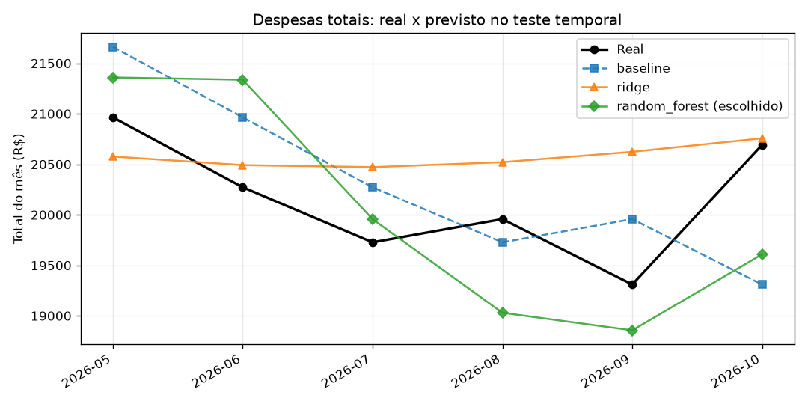

# Relatório de Machine Learning do ml-service

Todos os números vêm de dados **sintéticos** (ver `docs/ml-dataset.md`). Eles mostram que o pipeline funciona, não que o modelo funcionaria em um condomínio real.

## ML-03: previsão de despesas (`POST /predict/expenses`)

Código: `ml-service/scripts/train_expenses.py` (treino), `ml-service/app/services/expense_features.py` (features) e `ml-service/app/services/expense_predictor.py` (inferência).

### Método

- **Dados:** `expenses_total.csv`, 36 meses (2023-11 a 2026-10). As 3 primeiras linhas só servem de lag, sobram 33 exemplos.
- **Features:** mês-alvo como seno/cosseno, lags de 1 a 3 meses e média móvel de 3 meses.
- **Split temporal, sem embaralhar:** treino = 27 meses (2024-02 a 2026-04); teste = 6 meses (2026-05 a 2026-10). Nenhum choque do dataset afeta o teste nem os lags dele.
- **Pipeline:** `StandardScaler` + modelo; o scaler é ajustado só no treino.
- **Escolha do modelo:** validação de origem móvel *dentro do treino* (12 previsões de 1 mês à frente, retreinando a cada passo). O teste só mede o modelo já escolhido.
- **Candidatos:** baseline (repetir o último mês), `Ridge` (alpha em 1, 10 ou 100, escolhido na validação) e `RandomForestRegressor` (200 árvores, profundidade 4, `random_state=42`).

### Resultados no teste temporal (2026-05 a 2026-10)

| Modelo | MAE (R$) | RMSE (R$) | MAPE (%) | MAE na validação (R$) |
|---|---|---|---|---|
| baseline (último mês) | 699,14 | 779,41 | 3,45 | 2.205,18 |
| ridge (alpha=100) | 548,92 | 683,02 | 2,77 | 2.013,20 |
| **random_forest (escolhido)** | **692,16** | **772,41** | **3,42** | **1.453,16** |

O modelo escolhido pela validação (`random_forest`) supera o baseline no MAE de teste, **mas por pouco (R$ 6,98, cerca de 1%)**. Com 6 pontos de teste, essa diferença não é estatisticamente confiável.

### Por que o Ridge não foi o escolhido, apesar do MAE de teste menor

- A validação (27 meses de treino) inclui os choques de 2024-08 e 2025-03 e os meses seguintes, em que o lag 1 fica inflado. Modelos lineares e o baseline sofrem nesses meses; a floresta, que limita a saída aos valores vistos no treino, sofre menos. Por isso ela vence a validação.
- No teste não há choque. O Ridge com alpha alto (100) fica quase constante (ver gráfico) e acerta bem uma série que oscila pouco ao redor da média. É um resultado plausível, mas de 6 pontos.
- Escolher o modelo pelo MAE de teste seria usar o teste para decidir, o que a regra do projeto proíbe. A decisão foi mantida no procedimento. Se o time preferir outro critério, ele deve ser definido **antes** de olhar o teste de novo.

### Decisões de modelagem

- **Seno/cosseno do mês:** dezembro e janeiro ficam vizinhos, e o modelo aprende a sazonalidade (energia e água no verão) com 2 colunas, em vez de 11 dummies com 33 exemplos.
- **Lags 1 a 3 e média móvel de 3:** capturam nível e inércia. A média