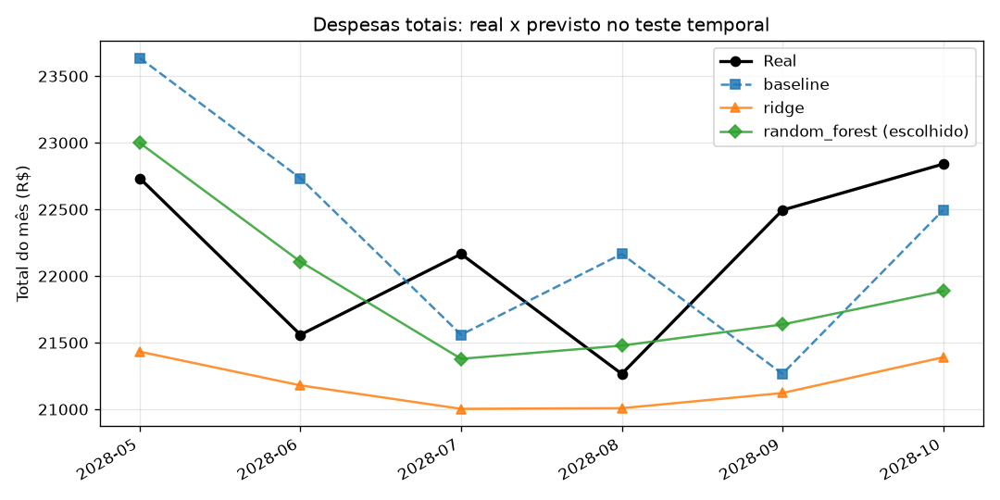
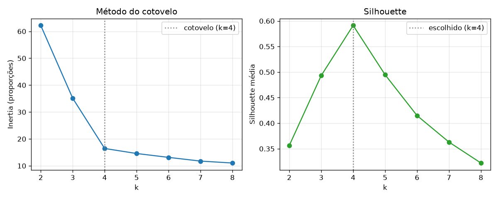
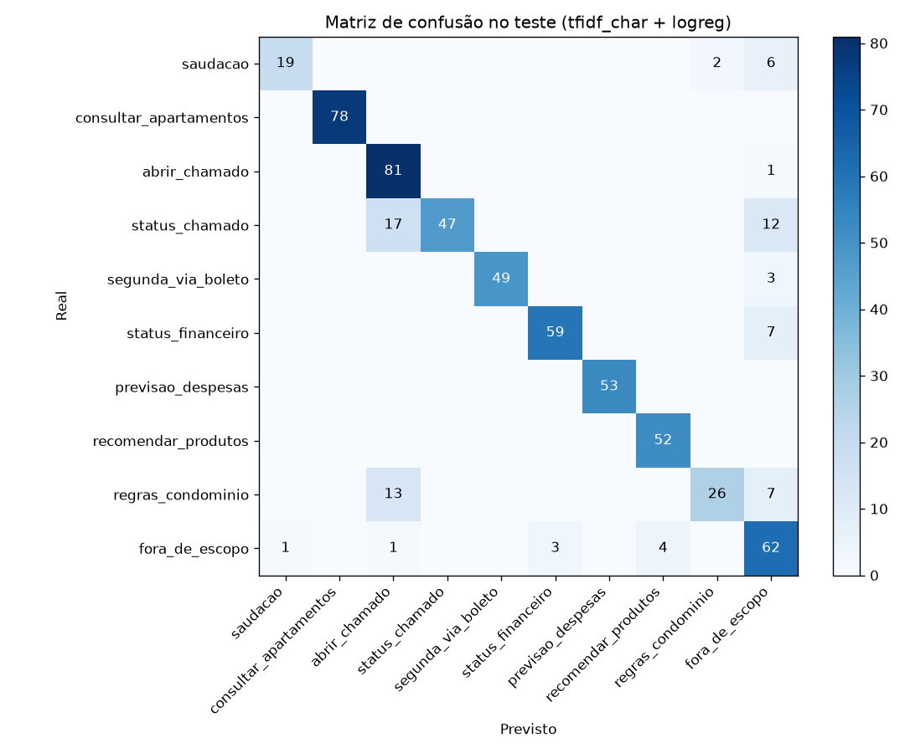

# Relatório de Machine Learning do ml-service

Todos os números vêm de dados **sintéticos** (ver `docs/ml-dataset.md`). Eles mostram que o pipeline funciona, não que o modelo funcionaria em um condomínio real.

## ML-03: previsão de despesas (`POST /predict/expenses`)

Código: `ml-service/scripts/train_expenses.py` (treino), `ml-service/app/services/expense_features.py` (features) e `ml-service/app/services/expense_predictor.py` (inferência).

### Método

- **Dados:** `expenses_total.csv`, 36 meses (2023-11 a 2026-10). As 3 primeiras linhas só servem de lag, sobram 33 exemplos.
- **Features:** mês-alvo como seno/cosseno, lags de 1 a 3 meses e média móvel de 3 meses.
- **Split temporal, sem embaralhar:** treino = 27 meses (2024-02 a 2026-04); teste = 6 meses (2026-05 a 2026-10). Nenhum choque do dataset afeta o teste nem os lags dele.
- **Pipeline:** `StandardScaler` + modelo; o scaler é ajustado só no treino.
- **Escolha do modelo:** validação de origem móvel *dentro do treino* (12 previsões de 1 mês à frente, retreinando a cada passo). O teste só mede o modelo já escolhido.
- **Candidatos:** baseline (repetir o último mês), `Ridge` (alpha em 1, 10 ou 100, escolhido na validação) e `RandomForestRegressor` (200 árvores, profundidade 4, `random_state=42`).

### Resultados no teste temporal (2026-05 a 2026-10)

| Modelo | MAE (R$) | RMSE (R$) | MAPE (%) | MAE na validação (R$) |
|---|---|---|---|---|
| baseline (último mês) | 699,14 | 779,41 | 3,45 | 2.205,18 |
| ridge (alpha=100) | 548,92 | 683,02 | 2,77 | 2.013,20 |
| **random_forest (escolhido)** | **692,16** | **772,41** | **3,42** | **1.453,16** |



O modelo escolhido pela validação (`random_forest`) supera o baseline no MAE de teste, **mas por pouco (R$ 6,98, cerca de 1%)**. Com 6 pontos de teste, essa diferença não é estatisticamente confiável.

### Por que o Ridge não foi o escolhido, apesar do MAE de teste menor

- A validação (27 meses de treino) inclui os choques de 2024-08 e 2025-03 e os meses seguintes, em que o lag 1 fica inflado. Modelos lineares e o baseline sofrem nesses meses; a floresta, que limita a saída aos valores vistos no treino, sofre menos. Por isso ela vence a validação.
- No teste não há choque. O Ridge com alpha alto (100) fica quase constante (ver gráfico) e acerta bem uma série que oscila pouco ao redor da média. É um resultado plausível, mas de 6 pontos.
- Escolher o modelo pelo MAE de teste seria usar o teste para decidir, o que a regra do projeto proíbe. A decisão foi mantida no procedimento. Se o time preferir outro critério, ele deve ser definido **antes** de olhar o teste de novo.

### Decisões de modelagem

- **Seno/cosseno do mês:** dezembro e janeiro ficam vizinhos, e o modelo aprende a sazonalidade (energia e água no verão) com 2 colunas, em vez de 11 dummies com 33 exemplos.
- **Lags 1 a 3 e média móvel de 3:** capturam nível e inércia. A média

## ML-05: recomendação de anúncios (`POST /recommend`)

Código: `ml-service/scripts/train_recommender.py` (treino), `ml-service/app/services/recommender_features.py` (vetor de interesse) e `ml-service/app/services/recommender.py` (inferência).

### Método

- **Dados:** `resident_profiles.csv`, 240 moradores. Os 8 sem histórico (vetor zero, não tem proporção) ficam fora do ajuste e testam o cold start; sobram 232.
- **Vetor de interesse:** por categoria, `1 x visualizações + 2 x anunciadas + 3 x conversas`. Pesos definidos antes de olhar os dados: conversar com o vendedor mostra mais intenção do que ver um anúncio.
- **Normalização:** `Normalizer(norm="l1")` dentro do `Pipeline`, que transforma o vetor em proporção por categoria (soma 1). Quem interage muito e quem interage pouco, com o mesmo gosto, ficam no mesmo ponto. Não aprende nada dos dados, então não há vazamento entre treino e teste. O `StandardScaler` foi descartado: as proporções já estão na mesma escala (0 a 1) e padronizar inflaria o peso de categorias raras.
- **Escolha do k:** K-Means (`n_init=10`, `random_state=42`) para k de 2 a 8, com inertia (cotovelo) e silhouette. O k escolhido é o de maior silhouette; o cotovelo (ponto mais distante da reta entre os extremos da curva) confere.

### Escolha do k

| k | Inertia | Silhouette |
|---|---|---|
| 2 | 35,04 | 0,374 |
| 3 | 19,53 | 0,502 |
| **4** | **9,47** | **0,597** |
| 5 | 8,24 | 0,511 |
| 6 | 7,16 | 0,447 |
| 7 | 6,44 | 0,377 |
| 8 | 5,94 | 0,354 |



**k = 4.** Os dois critérios apontam o mesmo valor: a inertia cai 51% de k=3 para k=4 e só 13% de k=4 para k=5 (o cotovelo), e a silhouette tem o pico em 0,597, acima de 0,5 (estrutura de grupos razoável). Com k=5 ou mais a silhouette cai porque o K-Means passa a dividir grupos que já eram coesos.

### Clusters encontrados (proporção média de interesse)

| Cluster | Moradores | móveis | eletrônicos | utensílios | esporte | outros | Perfil |
|---|---|---|---|---|---|---|---|
| 0 | 60 | 0,07 | **0,66** | 0,07 | 0,10 | 0,11 | eletrônicos |
| 1 | 68 | **0,51** | 0,08 | **0,32** | 0,03 | 0,06 | montando a casa |
| 2 | 48 | 0,09 | 0,12 | 0,16 | 0,07 | **0,55** | diversos |
| 3 | 56 | 0,06 | 0,12 | 0,07 | **0,57** | 0,18 | esporte |

Os números de cluster são arbitrários e mudam se o modelo for retreinado; a coluna "Perfil" é só uma leitura humana.

### Validação contra os grupos latentes (só para validar, nunca como feature)

| Medida | Valor |
|---|---|
| Silhouette (232 moradores) | 0,597 |
| ARI x grupos latentes | 0,861 |
| ARI em moradores fora do ajuste (20%, reajustando com 80%) | 0,766 |

O ARI de 0,86 mostra que os clusters recuperam os 4 grupos que o gerador usou. O valor fora do ajuste é menor porque são só 47 moradores e cerca de 8% dos perfis são mistos de propósito.

### Como recomenda

1. Monta o vetor, normaliza e atribui o cluster do morador (`predict`).
2. Força de cada categoria no cluster = proporção do centroide dividida pela maior do cluster (a categoria mais forte vale 1,0).
3. `score = 0,7 x força da categoria + 0,3 x popularidade`, com popularidade dividida pela maior entre os candidatos. O score fica entre 0 e 1.
4. Ordena por score (empate: menor `listingId`) e devolve os `topN`.
5. **Cold start** (nenhuma contagem): `cluster = -1` e o score é só a popularidade normalizada.

Por que 0,7 e 0,3: a categoria deve mandar (é o que o cluster diz sobre o gosto), e a popularidade só desempata entre anúncios da mesma categoria ou ajuda quando duas categorias têm força parecida. Não há dado real para ajustar esses pesos.

### Limitações

- Dados sintéticos: o k=4 e o ARI alto refletem os 4 grupos que o gerador criou. Em um condomínio real a estrutura pode ser mais difusa.
- O cluster usa só o tipo de interesse, não o preço. `preco` chega no contrato mas não entra no score.
- O serviço não sabe quais anúncios o morador já viu: o back envia só candidatos que ele ainda não viu nem anunciou.

### Como retreinar

```bash
cd ml-service
python -m scripts.train_recommender   # regrava artifacts/recommender_model.joblib e docs/img/ml-recommend-k-selection.png
pytest
```


## ML-04: NLU (`POST /nlu/parse`)

Código: `ml-service/app/services/text_preprocessing.py`, `intent_classifier.py`, `entity_extractor.py`, `nlu_parser.py` e `ml-service/scripts/train_intents.py` (treino).

### Método

- **Pré-processamento:** minúsculas, remoção de acentos e tokenização (`text_preprocessing.py`), usado dentro do `Pipeline`.
- **Divisão treino e teste:** `StratifiedGroupKFold` por `base_id` (1 dobra de 5 para o teste). Cada frase-modelo inteira, com suas variações, fica de um lado só, e cada intenção aparece nos dois lados. Resultado: 1.092 frases de treino (340 templates) e 272 de teste (84 templates), sem nenhuma frase em comum. Um split aleatório simples daria F1 de ~0,98 e não vale nada, porque a frase original estaria no treino e a variação no teste.
- **Candidatos:** 3 vetorizadores (TF-IDF de palavras, Bag-of-Words de palavras e TF-IDF de caracteres) x 3 modelos (`LogisticRegression`, `LinearSVC`, Naive Bayes), com um grid pequeno de hiperparâmetros (`C` da regressão logística: 1, 10 e 100; `alpha` do Naive Bayes: 0,1 e 1).
- **Escolha:** pela validação cruzada agrupada (4 dobras) dentro do treino, medindo o F1 macro com a regra de confiança da API. O conjunto de teste só é usado depois, para reportar.
- **Confiança:** `predict_proba`. Abaixo de 0,5 a API devolve `fora_de_escopo` (a confiança devolvida continua sendo a original).

### Resultado: tfidf_char + LogisticRegression (C = 100)

| Métrica no teste | Valor |
|---|---|
| Accuracy | 0,875 |
| **F1 macro** (com o limite de 0,5, como a API responde) | **0,873** (meta: 0,85) |
| F1 macro sem o limite | 0,907 |
| Baseline (classe mais frequente): accuracy / F1 macro | 0,132 / 0,023 |

### Comparação dos modelos

F1 de validação vem da validação cruzada do treino (é com ele que se escolhe). As colunas de teste são só informativas. O `LinearSVC` tem o melhor F1 bruto, mas não tem `predict_proba` e por isso não pode fornecer a confiança que a API exige; ele não concorre à escolha.

| Modelo | Hiperparâmetro | F1 valid. | Accuracy | F1 macro | F1 sem limite |
|---|---|---|---|---|---|
| tfidf_word + logreg | C = 100 | 0,771 | 0,849 | 0,854 | 0,868 |
| tfidf_word + linear_svc | C = 1 | 0,795 | 0,871 | 0,876 | 0,876 |
| tfidf_word + naive_bayes | alpha = 0,1 | 0,794 | 0,794 | 0,802 | 0,803 |
| bow_word + logreg | C = 100 | 0,751 | 0,842 | 0,838 | 0,842 |
| bow_word + linear_svc | C = 1 | 0,763 | 0,860 | 0,852 | 0,852 |
| bow_word + naive_bayes | alpha = 0,1 | 0,812 | 0,809 | 0,808 | 0,796 |
| **tfidf_char + logreg** | **C = 100** | **0,842** | **0,875** | **0,873** | **0,907** |
| tfidf_char + linear_svc | C = 1 | 0,853 | 0,926 | 0,927 | 0,927 |
| tfidf_char + naive_bayes | alpha = 0,1 | 0,825 | 0,901 | 0,900 | 0,901 |

**Por que `tfidf_char + logreg`:** o TF-IDF de caracteres (n-gramas de 2 a 5 dentro de cada palavra) foi o melhor vetorizador com folga, porque o dataset tem erros de digitação e gírias ("pracelas", "mosta", "canelo") que quebram o vocabulário por palavra. Entre os modelos com `predict_proba`, a regressão logística teve a melhor validação (0,842 contra 0,825 do Naive Bayes). O Bag-of-Words ficou claramente abaixo do TF-IDF com o mesmo modelo, o que justifica o ponderamento por TF-IDF. `C` baixo (1) dá probabilidades achatadas e o limite de 0,5 derrubaria quase tudo para `fora_de_escopo`; `C = 100` dá probabilidades utilizáveis (7,7% das frases de teste ficam abaixo de 0,5).

### Matriz de confusão (teste, comportamento da API)



| Intenção | Precision | Recall | F1 | Suporte |
|---|---|---|---|---|
| saudacao | 1,000 | 0,562 | 0,720 | 16 |
| consultar_apartamentos | 0,944 | 0,944 | 0,944 | 36 |
| abrir_chamado | 0,818 | 1,000 | 0,900 | 36 |
| status_chamado | 0,893 | 0,806 | 0,847 | 31 |
| segunda_via_boleto | 1,000 | 0,810 | 0,895 | 21 |
| status_financeiro | 1,000 | 0,931 | 0,964 | 29 |
| previsao_despesas | 1,000 | 1,000 | 1,000 | 24 |
| recomendar_produtos | 1,000 | 0,917 | 0,957 | 24 |
| regras_condominio | 0,889 | 0,727 | 0,800 | 22 |
| fora_de_escopo | 0,596 | 0,848 | 0,700 | 33 |

Os erros mais frequentes: `saudacao` e `status_chamado` caindo em `fora_de_escopo` (7 e 6 frases, quase todas por confiança abaixo de 0,5) e `regras_condominio` confundida com `abrir_chamado` (6 frases com vocabulário de reforma e obra). A baixa precision de `fora_de_escopo` vem do limite de confiança: ele "recolhe" frases válidas de baixa confiança.

### Ampliação dos exemplos

Com os 289 templates originais (24 a 52 por intenção), o F1 macro no teste agrupado ficou em ~0,80, abaixo da meta. Como a issue manda, ampliei os exemplos: +135 templates novos (de 289 para 424), escritos no fim de cada lista em `scripts/intent_templates.py` para os `base_id` antigos não mudarem, com mais negativos difíceis em `fora_de_escopo` (por exemplo "quanto custa um sofá novo?" e "meu notebook quebrou, onde conserto?"). Os outros quatro CSVs ficaram idênticos byte a byte. As frases do teste continuam sendo templates que o modelo nunca viu.

### Extração de entidades

Regex, uma função por entidade (`entity_extractor.py`), cada uma com testes positivos e negativos:

| Entidade | Exemplos reconhecidos | Saída |
|---|---|---|
| `unidade` | "apto 302", "ap. 302", "apartamento nº 58", "unidade 1204" | `"302"` |
| `bloco` | "bloco b", "Bloco B", "bl. c" (blocos A a D) | `"B"` |
| `equipamento` | elevador, portão, bomba, interfone, iluminação (e lâmpada) | `"portao"` (id ASCII) |
| `quartos` | "2 quartos", "dois quartos", "um quarto" | `2` |
| `valorMax` | "até 2 mil", "R$ 2.500", "1500 reais", "R$ 2,5 mil" | `2500.0` |
| `data` | "amanhã", "dia 10", "dia 15/11", "segunda-feira", "15 de novembro" | `"amanha"` (texto normalizado) |

### Limitações

- Dados sintéticos: as frases vêm de templates e as variações são geradas por regras; o F1 de 0,87 mostra que o pipeline funciona, não que acerta o jeito real de falar dos moradores.
- `saudacao` tem recall de 0,56: saudações de gíria que o modelo nunca viu ("salve", "eae") caem abaixo de 0,5 de confiança. Mais exemplos de gíria resolvem.
- A data sai como a expressão do texto, sem resolver para uma data: "amanhã" depende do dia de hoje, que é papel do back.
- O valor citado é sempre tratado como teto (`valorMax`), com ou sem "até".
- Blocos reconhecidos: A a D (`BLOCK_LETTERS`), para "bloco e o elevador" não virar o bloco E. Ampliar a constante se o condomínio tiver mais blocos.

### Como retreinar

```bash
cd ml-service
python -m scripts.generate_data   # só se mudar intent_templates.py
python -m scripts.train_intents   # regrava artifacts/intent_model.joblib e docs/img/ml-intents-confusion-matrix.png
pytest
```
