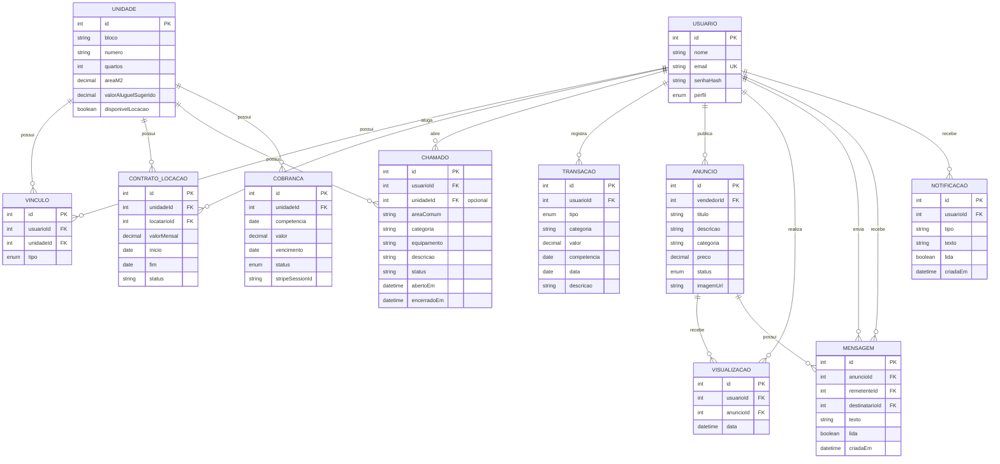

# Modelo de Dados - HabitaPlus

## Visão geral

O banco de dados do HabitaPlus utiliza PostgreSQL.

O acesso ao banco é realizado pelo TypeORM no backend NestJS.

As alterações da estrutura do banco são realizadas através de migrations.

O `synchronize` do TypeORM permanece desativado.

---

## Entidades

### Usuario

Representa os usuários do sistema.

Principais campos:

- id
- nome
- email
- senhaHash
- perfil

Perfis:

- MORADOR
- SINDICO
- ADMIN

---

### Unidade

Representa uma unidade do condomínio.

Principais campos:

- id
- bloco
- numero
- quartos
- areaM2
- valorAluguelSugerido
- disponivelLocacao

---

### Vinculo

Relaciona um usuário com uma unidade.

Principais campos:

- id
- usuario
- unidade (opcional para chamados de área comum)
- tipo

Tipos:

- PROPRIETARIO
- INQUILINO

---

### ContratoLocacao

Representa um contrato de locação.

Principais campos:

- id
- unidade
- locatario
- valorMensal
- inicio
- fim
- status

---

### Chamado

Representa solicitações ou chamados relacionados ao condomínio.

Principais campos:

- id
- usuario
- unidade (opcional para chamados de área comum)
- areaComum
- categoria
- equipamento
- descricao
- status
- abertoEm
- encerradoEm

---

### Transacao

Representa uma movimentação financeira.

Principais campos:

- id
- usuario
- tipo
- categoria
- valor
- competencia
- data
- descricao

`competencia` representa o período financeiro; `data` registra quando a
transação ocorreu.

Tipos:

- RECEITA
- DESPESA

---

### Cobranca

Representa uma cobrança vinculada a uma unidade.

Principais campos:

- id
- unidade
- competencia
- valor
- vencimento
- status
- stripeSessionId

Status:

- PENDENTE
- PAGA
- ATRASADA

---

### Anuncio

Representa um anúncio publicado por um usuário.

Principais campos:

- id
- vendedor
- titulo
- descricao
- categoria
- preco
- status
- imagemUrl

Status:

- DISPONIVEL
- VENDIDO

---

### Visualizacao

Registra uma visualização de anúncio.

Principais campos:

- id
- usuario
- anuncio
- data (data e hora da visualização)

---

### Mensagem

Representa uma mensagem relacionada a um anúncio.

Relaciona:

- anuncio
- remetente
- destinatario

Principais campos:

- texto
- lida
- criadaEm

---

### Notificacao

Representa uma notificação enviada para um usuário.

Principais campos:

- usuario
- tipo
- texto
- lida
- criadaEm

---

# Diagrama

As colunas `usuarioId` e `unidadeId` das relações são geradas pelo TypeORM a
partir de `@ManyToOne` e `@JoinColumn`; não é necessário declarar uma segunda
propriedade de ID na entidade. A migration inicial cria o schema para bancos
novos. Para bancos que já aplicaram a versão anterior, a migration
`AjustarDatasEUnidadeChamado1792290000000` adiciona o campo de data da
transação com base em `competencia` (não havia uma data específica confiável),
renomeia a data da visualização e torna `unidadeId` opcional. Ela preserva a
coluna JSONB histórica `transacoes.dados` para não descartar dados existentes;
essa coluna não é mais usada pela entidade.